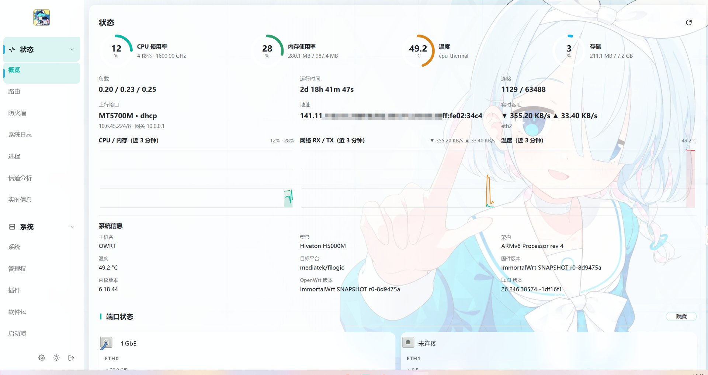
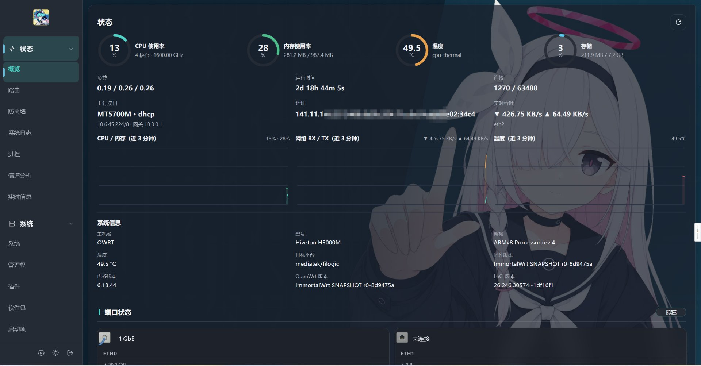
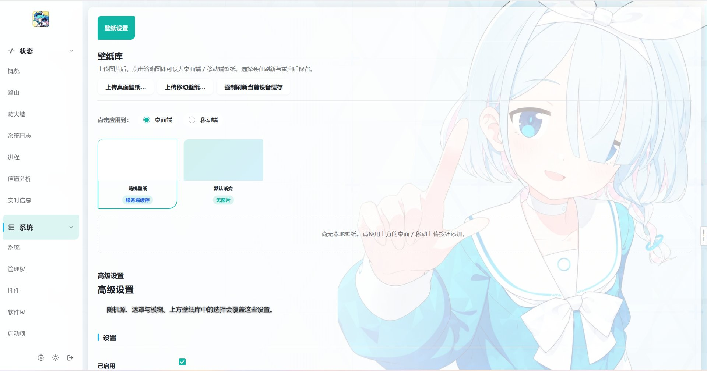
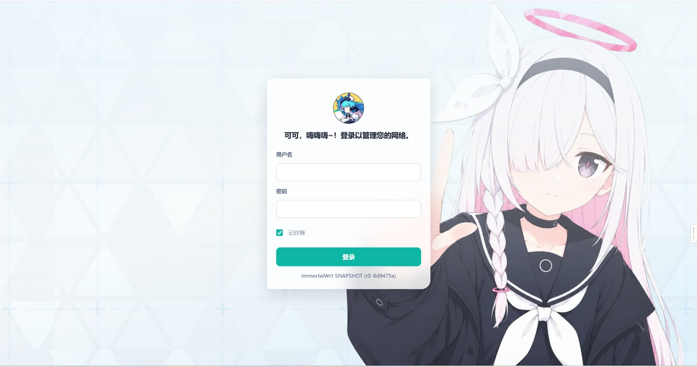
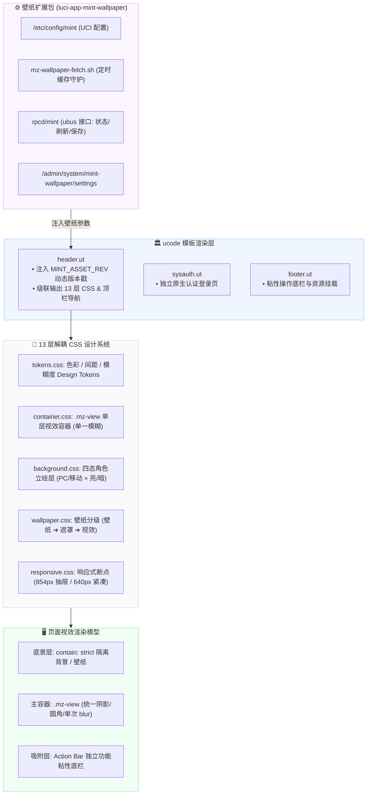
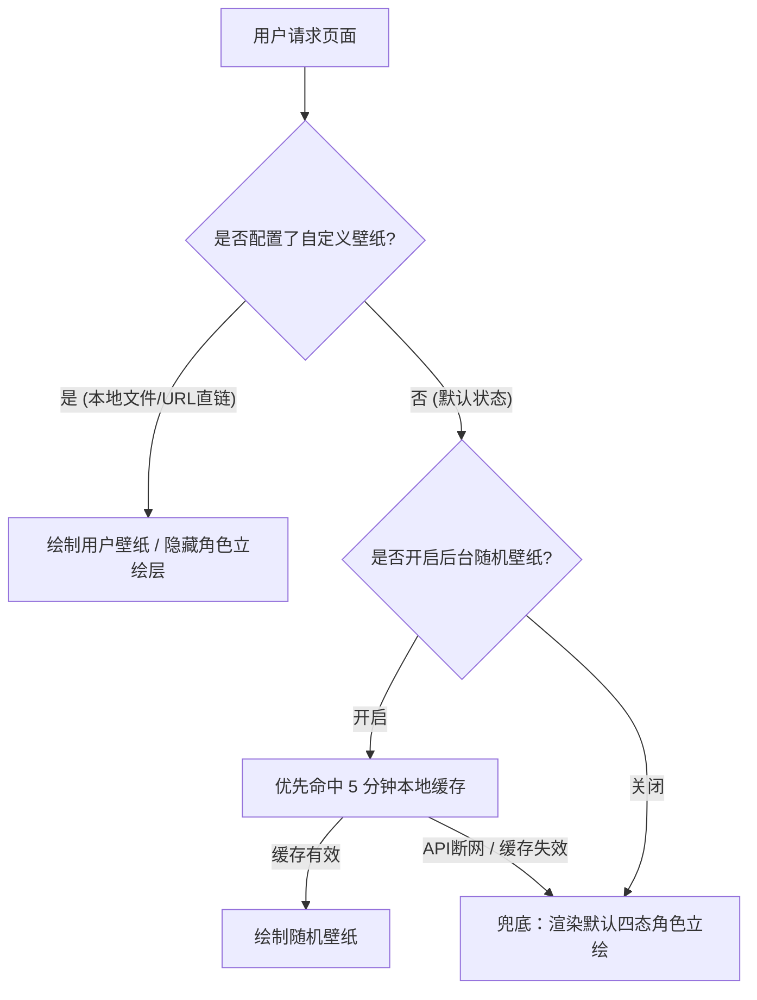

<div align="center">


# 🍃 Mint (luci-theme-mint)

<p align="center">
  <strong>面向 OpenWrt main / LuCI master 的下一代现代化原生玻璃拟态主题</strong>
</p>

<p align="center">
  <a href="https://github.com/LianXia233/luci-theme-mint/releases/latest"></a>
  <a href="https://openwrt.org/"></a>
  <a href="Makefile"></a>
  <a href="Makefile"></a>
  <a href="https://github.com/LianXia233/luci-theme-mint/releases/latest"></a>
  <a href="https://github.com/LianXia233/luci-theme-mint/actions/workflows/build.yml"></a>
  <a href="LICENSE"></a>
  <a href="https://github.com/LianXia233/luci-theme-mint/stargazers"></a>
</p>

<p align="center">
  <em>基于纯净 ucode 模板引擎 · Aurora Glass 玻璃拟态 · 单层视效容器 · 四态独立角色背景与壁纸系统 · 现代 Design Tokens</em>
</p>

<p align="center">
  <a href="#features">✨ 功能特性</a> •
  <a href="#previews">🖼️ 界面预览</a> •
  <a href="#quick-start">🚀 快速安装</a> •
  <a href="#architecture">📊 架构设计</a> •
  <a href="#wallpaper">🎨 背景机制</a> •
  <a href="#config">⚙️ 壁纸设置</a> •
  <a href="#build">📦 编译指南</a> •
  <a href="#compatibility">🌐 兼容性</a> •
  <a href="#faq">🛠️ 故障排查</a> •
  <a href="#license">📄 授权声明</a>
</p>

---

</div>

> [!NOTE]
> **原生架构说明**：本主题包名与路径已统一为 `mint`。底层基于 LuCI master 的纯 ucode 模板引擎与客户端渲染接口重构，并非针对旧主题的传统 CSS 覆写换肤，具备现代化的渲染性能与纯净度。

---

<a id="previews"></a>
## 🖼️ 界面预览

| 亮色模式 (Light Overview) | 暗色模式 (Dark Overview) |
| :---: | :---: |
| [](docs/previews/light-overview.jpg) | [](docs/previews/dark-overview.jpg) |
| **壁纸设置控制台 (Wallpaper Settings)** | **独立登录页 (Login Page)** |
| [](docs/previews/wallpaper-settings.jpg) | [](docs/previews/login.jpg) |

---

<a id="features"></a>
## ✨ 核心特性

### 🏛️ 结构工程与视觉规范
- **单层视觉容器架构**：全站仅保留一个主视觉容器 `.mz-view`，统一绘制背景、边框、圆角与阴影；内部 Section / CBI / 表格 / 卡片全部透明扁平化，坚决杜绝“卡片套卡片”的视觉杂乱。
- **单次模糊性能设计**：壁纸置于最底层，全页仅触发一次硬件级背景模糊计算，杜绝创建多重层叠上下文（Stacking Context），彻底消除下拉菜单被截断的顽疾；固定背景层使用 `contain: strict` 渲染隔离，移动端（$\le 854\text{px}$）自动降档模糊半径（10/12px），节约 50% GPU 开销。
- **沉浸式独立底栏**：Action Bar（底部操作栏）作为独立功能层，底部全出血粘性吸附（Sticky），交互自然沉浸。
- **解耦式 13 层 CSS 编排**：样式按职责严格拆分为 `compat / tokens / base / layout / navigation / container / components / wallpaper / background / dark / animations / responsive / login` 共十三层。`header.ut` 按级联顺序直接输出 13 个带独立动态版本戳的 `<link>`，全站资源受统一版本戳 `?v=<MINT_ASSET_REV>` 保护，更新后客户端零缓存残留。
- **明暗模式无缝切换**：原生支持 `跟随系统`、`明亮`、`暗黑` 三模循环切换，暗色模式基于深黑与磨砂质感优化，防止刺眼。

### 🎨 智能背景与壁纸生态
- **开箱即用四态角色立绘**：内置 PC/Mobile $\times$ Light/Dark 四套独立渲染的透明角色立绘（阿罗娜 / 普拉娜）与几何三角网格；纯 CSS 驱动，首帧秒出，无需复杂设置。
- **可选壁纸扩展包 (`luci-app-mint-wallpaper`)**：支持上传本地图片、配置 HTTP(S) 图片直链、或接入 Bing 等多组远程随机壁纸图源池（失败自动故障转移）。
- **离线与断网弹性兜底**：远程壁纸具有本地 5 分钟安全缓存，遇到外网波动或 API 故障时自动无缝降级至内置四态角色背景，页面渲染绝对不阻塞。

---

<a id="quick-start"></a>
## 🚀 快速安装与启用

本主题为全平台架构通用包（`PKGARCH=all` / `noarch`），无需区分 CPU 架构。前往 [Releases 最新发布页](https://github.com/LianXia233/luci-theme-mint/releases/latest) 下载即可。

### 1. 命令行快速安装

#### 方案 A：OpenWrt 25.12+ / ImmortalWrt SNAPSHOT (`apk` 包管理器)

```bash
# 1. 复制下载的 .apk 文件至路由器 /tmp 目录
# 2. 安装主题包与简体中文语言包（必须成对安装以支持中文）
apk add --allow-untrusted /tmp/luci-theme-mint-*.apk /tmp/luci-i18n-mint-zh-cn-*.apk

# 可选：安装壁纸设置管理器插件
apk add --allow-untrusted /tmp/luci-app-mint-wallpaper-*.apk /tmp/luci-i18n-mint-wallpaper-zh-cn-*.apk
```

#### 方案 B：OpenWrt 23.05 / 24.10 (`opkg` 包管理器)

```bash
# 1. 复制下载的 .ipk 文件至路由器 /tmp 目录
# 2. 安装主题与对应语言包
opkg install --force-downgrade /tmp/luci-theme-mint_*_all.ipk /tmp/luci-i18n-mint-zh-cn_*_all.ipk

# 可选：安装壁纸设置管理器插件
opkg install --force-downgrade /tmp/luci-app-mint-wallpaper_*_all.ipk /tmp/luci-i18n-mint-wallpaper-zh-cn_*_all.ipk
```

### 2. 主题生效与验证

安装或升级后，包管理器钩子会即时执行 `uci-defaults` 完成主题注册，**无需重启路由器**：

```bash
# 若需手动将 Mint 设为系统默认主题：
uci set luci.main.mediaurlbase='/luci-static/mint'
uci commit luci

# 重载 rpcd 服务使配置即时生效
/etc/init.d/rpcd reload
```

验证结果：执行 `uci get luci.themes.mint`，控制台应输出 `/luci-static/mint`。

---

<a id="architecture"></a>
## 📊 架构设计与渲染流



---

<a id="wallpaper"></a>
## 🎨 背景与壁纸机制详解

### 1. 默认背景：四态角色层（无需任何配置）
- **零 JS、首帧极速渲染**：环境判定与立绘映射完全由纯 CSS 媒体查询和 `data-theme` 属性闭环控制，明暗切换时两层立绘通过 `opacity` 柔和淡入淡出，请求零开销、零白屏闪烁。
- **高质轻量资产**：内置于 `theme/htdocs/luci-static/mint/images/`，包含 4 张独立四态构成立绘及 2 款三角网格 WebP 纹理。
- **绝对防御布局**：立绘层设置为 `position: fixed` 并置于负 `z-index`，同时设置 `pointer-events: none`，不在普通文档流内，杜绝产生横向滚动条。

### 2. 用户壁纸（可选，覆盖角色层）
- **登录页按需加载**：登录页默认仅展示普拉娜角色背景，仅当配置为 `mode='custom'`（显式指定直链或上传文件）时才加载用户壁纸。
- **后台随机保护**：后台随机壁纸默认处于关闭状态（`ui_random '0'`），开启后才会在路由导航时按规则拉取远程图。
- **自动隐退逻辑**：一旦启用了自定义壁纸，角色立绘层将自动设为 `display: none`，容器透明度恢复默认值。
- **深色模式纯净策略**：暗色模式默认不渲染大面积照片壁纸，直接保留深色底色与普拉娜立绘，杜绝任何外部随机壁纸网络请求。

### 3. 离线弹性兜底与执行流程



无论外部网络状况如何，页面渲染绝对不会被壁纸资源所阻塞。

### 4. 动态静态缓存戳机制 (`MINT_ASSET_REV`)
`MINT_ASSET_REV` 由 `wallpaper.uc#assetRev()` 动态生成：遍历主题静态资源树（排除用户上传等易变文件）的 `mtime` 并取最大值。
- 升级安装后 `mtime` 变化，所有 `?v=` 查询串自动失效，强制浏览器重新拉取最新样式；
- 两次升级之间数值高度稳定，正常浏览器缓存与 304 复用不受任何影响；
- 彻底告别了传统主题升级后用户必须手动按 `Ctrl + F5` 强制刷新浏览器的痛点。

---

<a id="config"></a>
## ⚙️ 壁纸设置 (UCI 参数)

壁纸功能控制面板位于：**系统 ➔ Mint 壁纸**（`/cgi-bin/luci/admin/system/mint-wallpaper/settings`），由独立包 `luci-app-mint-wallpaper` 驱动。

配置文件：`/etc/config/mint`

| 参数项 | 类型 | 默认值 | 详细说明 |
| :--- | :---: | :---: | :--- |
| `enabled` | 布尔 | `1` | 壁纸与角色背景总开关（置 `0` 时角色立绘层亦完全不注入） |
| `ui_random` | 布尔 | `0` | 管理后台是否使用随机壁纸（默认关闭，由原生角色背景顶替） |
| `pc_mode` | 枚举 | `random` | 桌面端来源：`random`（随机图源）/ `custom`（自定义壁纸） |
| `pc_wallpaper` | 文件名 | *空* | 桌面端已上传壁纸库中的文件名（优先级高于直链与随机源） |
| `pc_url` | 直链 | *空* | 桌面端自定义图片的 HTTP(S) 直链地址 |
| `pc_sources` | 列表 | `paugram`<br>`t.alcy.cc/bd` | 桌面随机源池（每行一个 URL，系统随机挑选，失败自动故障转移） |
| `mobile_mode` | 枚举 | `random` | 移动端来源：`random`（随机图源）/ `custom`（自定义壁纸） |
| `mobile_wallpaper` | 文件名 | *空* | 移动端壁纸库选中的文件名（优先级高于直链与随机源） |
| `mobile_url` | 直链 | *空* | 移动端自定义图片的 HTTP(S) 直链地址 |
| `mobile_sources` | 列表 | `seaya`<br>`t.alcy.cc/mp` | 移动端随机源池（按行轮询分配与故障重试） |
| `overlay` | 浮点 | `0.45` | 深色遮罩不透明度（调节范围：`0.0` - `1.0`） |
| `blur` | 整数 | `0` | 背景模糊像素滤镜半径（单位：`px`，`0` 为禁用，上限 `40`） |

> [!TIP]
> 上传的图片自动存放于 `/www/luci-static/mint/wallpapers/`；卸载软件包时系统将自动清空此目录。

---

<a id="build"></a>
## 📦 编译指南

### 1. 云端编译（GitHub Actions）
推送到 `main` 分支或打版本标签（`v*`）时将自动触发 CI 流水线；可在 Actions 控制台点击 `workflow_dispatch` 手动触发。流水线将一次性打包输出 `luci-theme-mint` 与 `luci-i18n-mint-zh-cn` 的全套 `.apk` 和 `.ipk` 制品。

### 2. 官方预编译 SDK 本地构建（推荐）

```bash
# 1. 抓取目标架构 SDK（以 x86_64 为例）
BASE=https://downloads.openwrt.org/snapshots/targets/x86/64
SDK=$(curl -fsSL "$BASE/" | grep -o 'openwrt-sdk-.*tar.zst' | head -1)
curl -fsSLO "$BASE/$SDK"
tar --zstd -xf "$SDK" && mv openwrt-sdk-* sdk && cd sdk

# 2. 更新基础 feeds
./scripts/feeds update -a

# 3. 注入主题源码并建立链接
mkdir -p feeds/luci/themes/luci-theme-mint
cp -a /本地路径/luci-theme-mint/theme/. feeds/luci/themes/luci-theme-mint/
./scripts/feeds install -a
mkdir -p package/feeds/luci
ln -sfn ../../../feeds/luci/themes/luci-theme-mint package/feeds/luci/luci-theme-mint

# 4. 勾选包并生成配置
echo "CONFIG_PACKAGE_luci-theme-mint=m" >> .config
echo "CONFIG_PACKAGE_luci-i18n-mint-zh-cn=m" >> .config
echo "CONFIG_LUCI_JSMIN=y" >> .config
make defconfig

# 5. 单包快速编译
make package/feeds/luci/luci-base/host/compile -j$(nproc) V=s
make package/feeds/luci/luci-theme-mint/compile -j$(nproc) V=s
```

---

<a id="compatibility"></a>
## 🌐 兼容性与运行环境

| 发行版体系 | 最低版本 | 模板引擎 | 包管理格式 | 适配状态说明 |
| :--- | :---: | :---: | :---: | :--- |
| **OpenWrt** | 23.05+ / main | ucode (`.ut`) | `.ipk` / `.apk` | 官方主线完美兼容，25.12+ 推荐 `.apk` |
| **ImmortalWrt** | 21.02+ | ucode | `.apk` / `.ipk` | 全面适配，原生支持基于 apk 的包管理模式 |
| **LEDE / OpenWrt ≤ 19.07** | — | Lua 模板 | — | ❌ **不支持**（缺少 ucode 模板引擎与 rpcd ACL 体系） |

### 运行时依赖清单

| 依赖包名 | 必需度 | 用途说明 |
| :--- | :---: | :--- |
| `luci-base` | **必需** | 驱动 ucode 模板解析、ACL 权限校验、ubus 桥接及 cbi 核心组件 |
| `curl` | **必需** | 服务端定时壁纸抓取脚本 `mz-wallpaper-fetch.sh` 必需组件 |
| `rpcd` (`mint` 命名空间) | **必需** | 承载实时监控 dashboard 与壁纸强制刷新 API |
| `luci-i18n-mint-zh-cn` | 推荐 | 主题简体中文语言包（需要中文界面时与主题包成对安装） |

---

<a id="faq"></a>
## 🛠️ 故障排查

<details>
<summary><strong>Q: 安装后主题列表中未出现 Mint 选项？</strong></summary>

> 正常情况下安装完成后即由 `uci-defaults` 自动完成注册。若由于特殊环境未生效，请通过 SSH 执行：
> ```bash
> sh /etc/uci-defaults/30_luci-theme-mint
> /etc/init.d/rpcd reload
> ```
</details>

<details>
<summary><strong>Q: 随机壁纸加载变慢或无法显示？</strong></summary>

> 随机壁纸由浏览器向外部图源发起请求。如果当前路由器网络受限或外部图源波动，主题会自动优雅降级展示内置的四态透明角色立绘。如需完全离线稳定展示，建议在 **系统 ➔ Mint 壁纸** 中上传本地图片。
</details>

<details>
<summary><strong>Q: 如何快速切换明亮 / 深色模式？</strong></summary>

> 点击左侧导航栏底部的色彩模式切换按钮，即可在 `跟随系统` ➔ `浅色模式` ➔ `深色模式` 之间顺畅循环切换。
</details>

---

<a id="license"></a>
## 📄 许可证与知识产权声明

### 1. 开源许可证

本项目主题源码以 **GNU General Public License v3.0**（`GPL-3.0-only`）发布。完整许可证文本见仓库根目录 [`LICENSE`](./LICENSE)。

- 覆盖范围：`theme/`（`ucode/` 模板、`htdocs/` 下的 CSS / JS，**不含** `images/` 内的角色素材）、`wallpaper/`、`scripts/` 以及 `docs/` 原创文档。
- 分发约束：分发 `.ipk` / `.apk` 或二次修改版本时，须随附完整的对应源码，并完整保留原有版权与授权声明。

### 2. 界面角色素材版权归属

主题内置两组来源不同的角色美术素材，其权利归属各自独立，**均不在 GPL-3.0 授权范围内**：

**2.1 主题 Logo ——「薄荷」（Mint）**
- 对应文件：`assets/logo.png`
- 角色与作品：薄荷（Mint） / 《异环》（Neverness to Everness, NTE）
- 著作权人：苏州幻塔网络科技有限公司（Hotta Studio，完美世界旗下工作室） / 完美世界游戏

**2.2 四态背景立绘 ——「阿罗娜」与「普拉娜」**
- 对应文件：`theme/htdocs/luci-static/mint/images/character-{pc,mobile}-{light,dark}.webp`
- 角色与作品：阿罗娜（Arona） & 普拉娜（Plana） / 《蔚蓝档案》（Blue Archive）
- 著作权人：NEXON Games Co., Ltd.

> **特别声明**：素材仅用于个人界面的视觉装饰，不构成商业授权或官方合作背书。本项目与完美世界、Hotta Studio、NEXON Games 及 Yostar 之间均不存在任何明示或暗示的赞助、合作或隶属关系。替换立绘指引请参考 [`docs/character-background.md`](docs/character-background.md)。

---

## 📂 源码目录结构

```text
luci-theme-mint/
├── theme/                                        # 主题核心包 (luci-theme-mint)
│   ├── Makefile                                  # 主题打包规格定义 (PKGARCH:=all)
│   ├── ucode/template/themes/mint/               # ucode 核心模板 (header.ut / footer.ut / sysauth.ut)
│   ├── ucode/mint/wallpaper.uc                   # 动态版本戳 MINT_ASSET_REV 与配置解析器
│   ├── htdocs/luci-static/mint/
│   │   ├── css/                                  # 13 层解耦 CSS 设计系统
│   │   ├── images/                               # 四态角色背景与三角网格资产
│   │   ├── overview-dashboard.js                 # 响应式概览仪表盘组件
│   │   └── mz-ui.js                              # 原生交互驱动层
│   └── po/zh_Hans/luci-theme-mint.po             # 主题简体中文语言包
├── wallpaper/                                    # 壁纸扩展包 (luci-app-mint-wallpaper)
│   ├── Makefile                                  # 扩展包打包定义
│   ├── htdocs/luci-static/resources/view/mint/   # 壁纸可视化管理界面 (wallpaper.js)
│   ├── root/usr/bin/mz-wallpaper-fetch.sh        # 服务端壁纸定时抓取守护脚本
│   └── root/usr/libexec/rpcd/mint                # ubus RPC 服务端接口
├── assets/logo.png                               # 主题 Logo 视觉资产
├── docs/previews/                                # 界面实际运行预览图
└── README.md                                     # 项目详细使用指南
```

<div align="center">

**如果 Mint 主题让你的路由器控制台焕然一新，欢迎点一个 ⭐️ Star 给予支持！**

</div>
